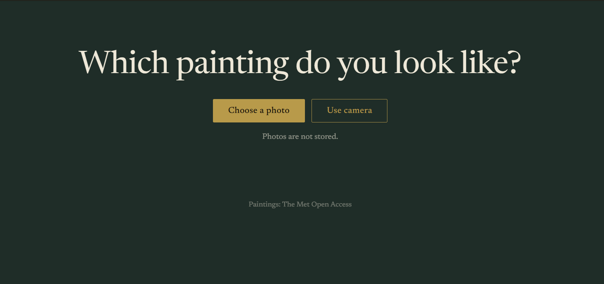
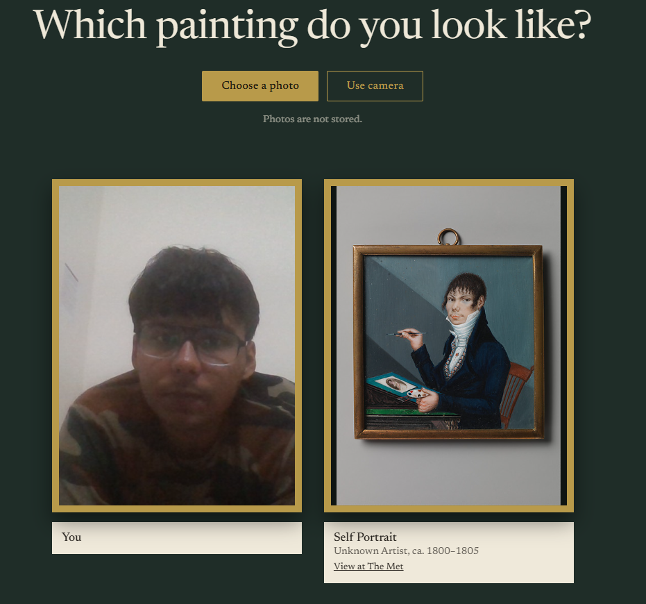
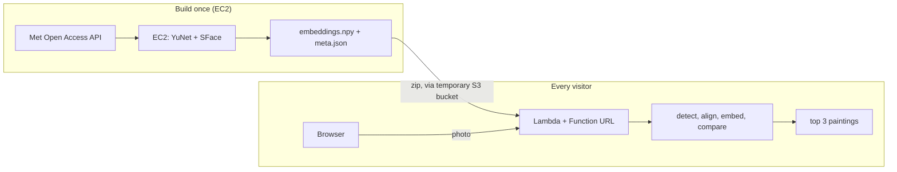

# Art Twin

Take a selfie and find the portrait paintings in The Metropolitan Museum of Art whose faces look most like yours.

Built on AWS with OpenCV face models. The photo is processed in memory and never stored.

<p align="center">


</p>


> The live demo is not kept online, to avoid cost and public abuse. You can deploy your own copy in about 4 minutes (see Quick start).

## How it works

A normal classifier picks one label from a fixed list. There is no fixed list of faces, so this project matches faces instead:

1. **Detect**: YuNet finds the face and five landmarks (eyes, nose tip, mouth corners).
2. **Align**: the landmarks are used to crop the face to a standard 112x112 image.
3. **Embed**: SFace turns the aligned face into 128 numbers, scaled to length 1.
4. **Compare**: the dot product with every stored painting vector gives the cosine similarity. The 3 highest are returned.

```python
sims = E @ feat                    # E: (n_paintings, 128), feat: (128,)
top = np.argsort(sims)[::-1][:3]
```

Scores are relative similarities, not probabilities. A selfie compared with a painting of a different person usually scores low, so the result means "closest available face", not identity.

## Architecture



| Service | Role |
|---|---|
| EC2 (Ubuntu, t3.micro, ap-south-1) | Build machine: downloads models, builds the painting dataset, runs the deploy script |
| IAM role | Lets the build machine deploy without storing access keys on it |
| S3 | Temporary bucket that carries the deployment zip to Lambda (it is larger than the direct upload limit) |
| Lambda (Python 3.12, 1024 MB, 30 s) | Serves the web page on GET and does the matching on POST |
| Lambda Function URL | Public https address (https is needed for the browser camera) |

Why serverless: one short job per request, no idle cost, scales with visitors, and no photos need to be stored. A traditional always-on EC2 server with S3 storage would make sense if uploaded images had to be kept.

## Repository structure

art-twin/
│
├── lambda/
│   ├── handler.py          # Lambda backend + matching logic
│   └── index.html           # Web interface (upload or camera)
│
├── build_embeddings.py      # Builds embeddings.npy and meta.json from Met API
├── deploy.sh                # Packages and deploys to AWS Lambda
├── teardown.sh              # Removes Lambda function and its role
│
├── embeddings.npy            # 128-dimensional painting embeddings
├── meta.json                 # Painting metadata
├── requirements.txt
│
├── docs/
│   ├── img/                  # Project screenshots and diagrams
│   ├── Introduction_to_Cloud_Computing...  # Existing document
│   └── SETUP.md              # Manual AWS setup instructions
│
├── .gitignore
├── LICENSE
└── README.md                 # Main project documentationart-twin/
│
├── lambda/
│   ├── handler.py          # Lambda backend + matching logic
│   └── index.html           # Web interface (upload or camera)
│
├── build_embeddings.py      # Builds embeddings.npy and meta.json from Met API
├── deploy.sh                # Packages and deploys to AWS Lambda
├── teardown.sh              # Removes Lambda function and its role
│
├── embeddings.npy            # 128-dimensional painting embeddings
├── meta.json                 # Painting metadata
├── requirements.txt
│
├── docs/
│   ├── img/                  # Project screenshots and diagrams
│   ├── Introduction_to_Cloud_Computing...  # Existing document
│   └── SETUP.md              # Manual AWS setup instructions
│
├── .gitignore
├── LICENSE
└── README.md                 # Main project documentation


## Quick start (deploy your own copy)

Requirements: an AWS account, and a terminal with the AWS CLI logged in (AWS CloudShell works).

```bash
git clone https://github.com/<your-username>/<your-repo>.git
cd <your-repo>
bash deploy.sh
```

The script downloads the two models, builds a Lambda-compatible package, creates the function and prints a `LIVE AT` URL. To remove everything afterwards: `bash teardown.sh`.

## Rebuild the dataset

```bash
pip install -r requirements.txt
Z=https://github.com/opencv/opencv_zoo/raw/main/models
curl -sL -o yunet.onnx $Z/face_detection_yunet/face_detection_yunet_2023mar.onnx
curl -sL -o sface.onnx $Z/face_recognition_sface/face_recognition_sface_2021dec.onnx
python3 build_embeddings.py 400
```

The script queries the Met Open Access API for public-domain portrait paintings, runs face detection on each image and keeps paintings where a face at least 40 px wide is found. The first complete build kept 63 paintings because many requests failed or had no usable face.

For the full manual walk-through (account safety, EC2, SSH, environment), see [docs/SETUP.md](docs/SETUP.md).

## Data and licences

- Paintings and metadata: The Metropolitan Museum of Art Open Access collection (public domain, CC0).
- Models: YuNet and SFace from the [OpenCV Zoo](https://github.com/opencv/opencv_zoo). Check the licence file in each model folder before redistributing the `.onnx` files. They are downloaded by the scripts and are not committed here.
- Project code: MIT, see [LICENSE](LICENSE).

## Privacy and security

- Photos are decoded in memory and are not written to disk or storage.
- The Function URL is public by design. Set a budget alert, and run `teardown.sh` when you are not using it.
- Never commit `.pem` key files or credentials. Face images and data of real people should only be collected with consent.

## Limitations

- Small reference set, so the best match is sometimes only the least bad one.
- Painted faces differ from photographs, so results are for fun and not a measure of identity.
- Not suitable for attendance, ID checks or security use. That would need a stronger model, liveness detection and consent.

## Roadmap

- Larger painting set and a proper retrieval evaluation.
- Benchmark latency and cost on laptop CPU, EC2, Lambda (several memory sizes) and GPU.
- Infrastructure as code (CloudFormation or Terraform) and automated tests.

## Author

Himanshu Rai, B.Sc. Mathematics (Hons). Built for the course Introduction to Cloud Computing.[View the pdf](docs/Introduction_to_Cloud_Computing.pdf)
